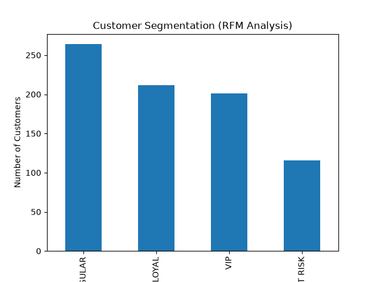
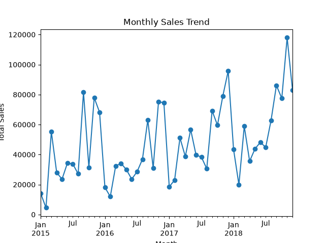
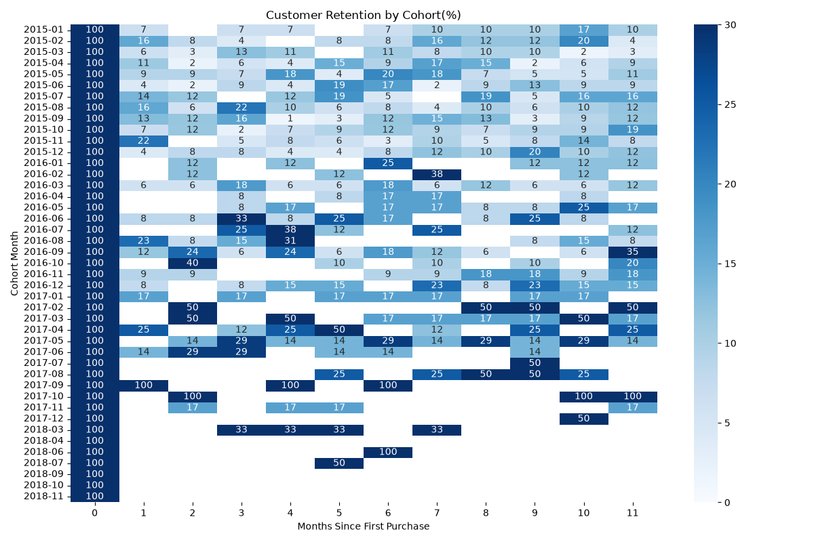
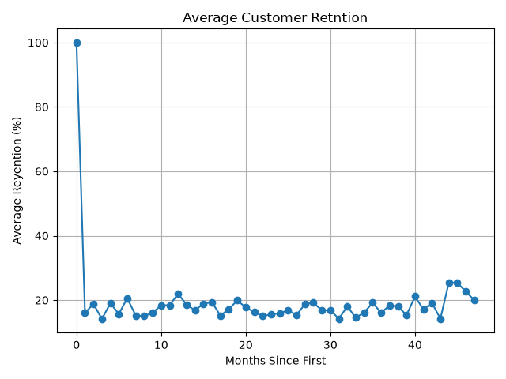

# Superstore Sales Analytics: RFM Segmentation & Cohort Retention

A Python (pandas) analysis of a retail store's sales (2015–2018) that answers core business questions, segments customers with RFM analysis, and measures customer retention with cohort analysis.

Dataset: [Superstore Sales](https://www.kaggle.com/) (9,800 order lines, 793 customers). Download train.csv from Kaggle and place it next to the script.

## Business Questions

1. What are the total sales?
2. Which product sells the most?
3. Which city buys the most?
4. Which month has the highest sales?
5. What is the average order value?
6. Who are the most valuable customers?
7. How many customers come back after their first purchase?

## Key Findings

| Metric | Result |
|---|---|
| Total sales | 2,261,536.78 |
| Top product | Canon imageCLASS 2200 Advanced Copier (61,599.82) |
| Top city | New York City (252,462.55) |
| Best month | November 2018 (117,938.16) |
| Average order value | 459.48 |

### Customer Segments (RFM)

| Segment | Customers | Revenue |
|---|---|---|
| VIP | 201 | 944,678 |
| Loyal | 212 | 771,826 |
| Regular | 264 | 456,476 |
| At Risk | 116 | 88,557 |

VIP + Loyal customers (52% of the customer base) generate about 76% of total revenue.

### Retention

Most monthly cohorts retain only 5%–20% of customers after their first month. Very high values (50%, 100%) appear only in recent cohorts with 1–2 customers and are statistical noise, not real loyalty.

## Charts

## Recommendations

1. Protect the VIP and Loyal segments. They bring about three quarters of revenue: offer early access, loyalty rewards, and priority service.
2. Prepare for the seasonal peak. Sales spike every September–December (highest in November). Plan inventory and ad budget ahead of this period.
3. Run re-targeting campaigns after the first purchase. Retention is low, so send a follow-up email or discount within 30 days of a customer's first order.
4. Win back "At Risk" customers with a targeted offer before they are lost for good.

## How It Works

- Cleaning: convert dates, handle missing postal codes.
- Analysis: groupby aggregations for products, cities, months, and order values (order totals are computed per Order ID, not per row).
- RFM: Recency, Frequency, Monetary scored 1–4 with pd.qcut, summed, and cut into 4 segments.
- Cohorts: customers grouped by first-purchase month; retention = share of the cohort still ordering N months later.

## Run It

pip install pandas matplotlib seaborn
python pandas_part.py
## Tools

Python, pandas, matplotlib, seaborn